<div align="center">

# gzh-skill-kit

### Turn a finished article into a WeChat-ready layout

Let your AI agent handle the layout, so you can focus on the content.

**14 themes · Markdown / Word / PDF · Rich-text copy · Optional draft upload**

[](LICENSE)
[](https://github.com/88lin/gzh-skill-kit/actions/workflows/validate.yml)
[](references/theme-index.md)
[](CONTRIBUTING.md)

[Live gallery](https://88lin.github.io/gzh-skill-kit/docs/gallery/index.html) · [Quick start](#quick-start) · [Tutorials](#tutorials) · [Draft upload](#wechat-api) · [Troubleshooting](#faq)

[中文](README.md) / **English**

</div>

---

**gzh-skill-kit is a WeChat Official Account layout skill for AI agents.** Supply an article and the agent reads the theme components, organizes sections and emphasis, runs HTML checks, and delivers an article fragment plus a preview with a copy button. Use a client that can load skill instructions, work with local files, and run commands, such as Claude Code, Codex, or Cursor. Installation paths depend on the client.

It suits tutorials, reviews, reading notes, essays, and newsletters. The workflow formats existing content; Word, PDF, and plain text are first normalized to Markdown. **The agent assembles the themed HTML. Python scripts handle extraction, validation, previews, and upload; there is no standalone Markdown-to-themed-HTML renderer CLI.**

<table>
<tr>
<td width="33%" align="center"><a href="https://88lin.github.io/gzh-skill-kit/docs/gallery/tech-cobalt.html">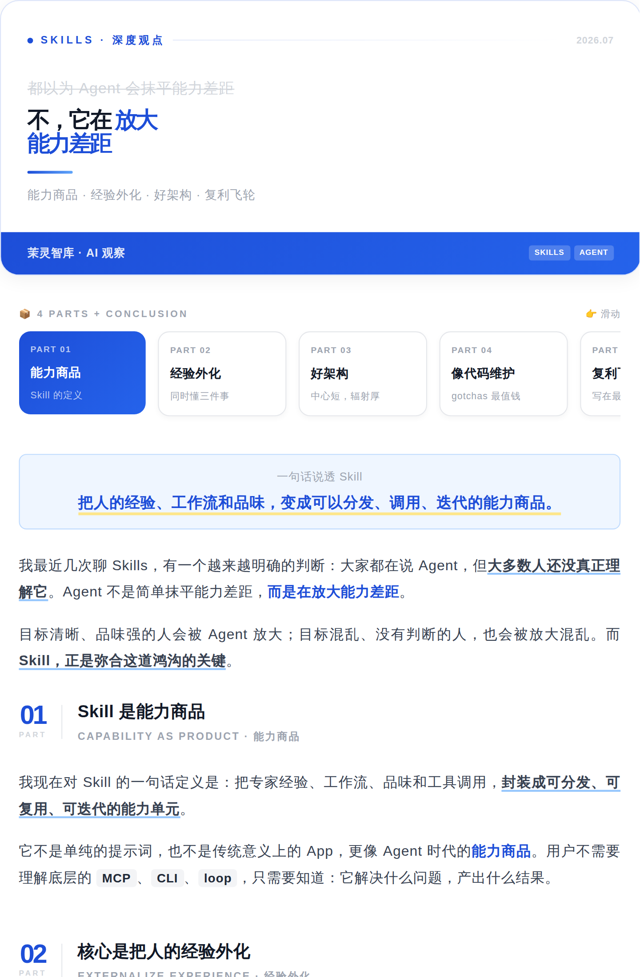</a><br><b>Tech Cobalt</b><br><sub>AI tools · Developer tutorials</sub></td>
<td width="33%" align="center"><a href="https://88lin.github.io/gzh-skill-kit/docs/gallery/letter.html">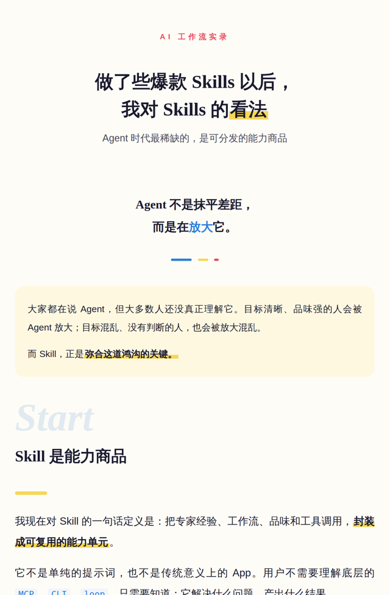</a><br><b>Cream Letter</b><br><sub>Narratives · Annual reflections</sub></td>
<td width="33%" align="center"><a href="https://88lin.github.io/gzh-skill-kit/docs/gallery/bento.html"></a><br><b>Pastel Bento</b><br><sub>Tool reviews · Resource lists</sub></td>
</tr>
</table>

<p align="center"><sub>Click a thumbnail to read the full sample. More styles are listed below.</sub></p>

<a id="quick-start"></a>

## Quick start

### 1. Prepare your environment and install

| Requirement | Purpose |
| --- | --- |
| An AI agent with skill support | Read components, interpret the article, and generate HTML |
| Python 3 (3.13 recommended, matching CI) | Run validation, preview, and Word extraction scripts |
| Node.js LTS / npm | Needed for the `npx` installation below |
| A browser | Open the preview and copy rich text |

Run this in a terminal, then follow the installer prompts to select your client and installation scope:

```bash
npx skills add https://github.com/88lin/gzh-skill-kit
```

The repository is named `gzh-skill-kit`; the skill name in [SKILL.md](SKILL.md) is **`gzh-design`**. After installation, check that your client can discover it. Reload the client or start a new session if needed.

<details>
<summary>Other installation options: ask your agent, or install manually</summary>

Send your agent this prompt:

```text
Install the skill at https://github.com/88lin/gzh-skill-kit using this
client's skill directory conventions. Confirm that you can read SKILL.md
and run the validation scripts.
```

For a project-level Claude Code installation, run this from your project directory (Git required):

```bash
git clone https://github.com/88lin/gzh-skill-kit.git .claude/skills/gzh-design
```

For other clients, use their supported skill directories. Check local changes before replacing an existing installation, especially custom themes.

</details>

### 2. Format your first article

Send this in your agent's chat, replacing the file path and author details:

```text
Use gzh-design to format article.md for WeChat with the tech-cobalt theme.
Preserve the article's content. Use "Your Name" as the author and
"Your short bio" as the signature introduction.
Run validation and create a preview with the "复制到公众号" copy button.
```

No article yet? Try the included [sample article](assets/sample-article.md):

```text
Read assets/sample-article.md from the gzh-design skill directory.
Format it with tech-cobalt, save the output in my current working directory,
run validation, and generate the preview page.
```

### 3. Open, copy, and check in WeChat

For `article.md`, the standard output consists of two files. Filenames use the theme's registered Chinese name:

| File | Purpose |
| --- | --- |
| `article_排版_科技钴蓝(tech-cobalt).html` | Clean article fragment for validation and API upload |
| `article_排版_科技钴蓝(tech-cobalt)_预览.html` | Browser preview with the copy button |

1. Open **`_预览.html`** in your browser. Check sections, author details, images, and code blocks.
2. Click **复制到公众号** (Copy to WeChat) at the top right.
3. Paste into the article body in the WeChat editor (`Ctrl+V` on Windows, `⌘V` on macOS).
4. Use WeChat's preview feature to check the article on a phone before publishing it yourself.

> [!TIP]
> Copy the rendered rich text, not the HTML source. Use the clean article fragment for validation and API upload, not the full preview page.

<a id="tutorials"></a>

## Tutorials

### Choose how much control you want

| Goal | Tell your agent | Behavior |
| --- | --- | --- |
| Use a specific style | "Format article.md with red-white" | Uses the selected theme directly |
| Get a recommendation | "Format this article for WeChat" | Recommends a theme for confirmation |
| Finish in one pass | "Auto-format article.md; choose the theme without asking" | Infers structure and theme, then explains its choices |
| Review the emphasis first | "Annotate article.md first; do not generate HTML yet" | Delivers `_annotated.md` before rendering |
| Compare styles | "Make tech-cobalt and letter versions" | Produces a separate article and preview for each |

**Tech Cobalt** is the default recommendation when no theme is specified and the topic has no clear match. Use either a theme's Chinese name or its ID from the table below.

### Tutorial 1: Prepare Markdown with clear structure

Use `#` for the article title and `##` for sections. Explicit quotes, emphasis, images, and code blocks help the agent follow your intended structure.

````markdown
# Automate a repetitive task

> Start small and get one workflow running.

## Choose the first task

Pick a **frequent, predictable** operation. Record its ++inputs and outputs++.

- Define what triggers it
- Keep a manual review step

## Check the result

```python
print("Hello, workflow!")
```

Reference: [Project documentation](https://example.com/docs)
````

For an image, add `` and make sure the file exists. Code components offer dark/light backgrounds and syntax highlighting, with long lines wrapping according to the component rules. Regular links become numbered footnotes and a references section. `++text++` and `==text==` are skill-specific emphasis conventions; see the [workflow](SKILL.md) for the mappings.

### Tutorial 2: Start with Word, PDF, or plain text

```text
Convert article.docx to Markdown and let me check its sections and images.
After confirmation, format it with letter. Preserve the substantive content;
do not write replacement paragraphs.
```

| Input | Handling and limitations |
| --- | --- |
| `.docx` | Extracts headings, bold text, lists, external links, tables, and embedded images; merged cells become ordinary cells |
| `.doc` | Save as `.docx` in Word or WPS first |
| `.pdf` | Requires your agent's PDF reading capability; removes headers, footers, and hard line breaks; figures become placeholders. Check scanned or multi-column documents separately |
| `.txt` / pasted text | Infers sections and headings; identifies newly proposed headings during structure review |

You can also extract Word content yourself. Run this and all later `scripts/...` commands from the **skill installation directory or repository root**. Replace input paths with your actual files; use `python3` instead of `python` if required by your system.

```bash
python scripts/extract_docx.py "/path/to/article.docx" -o "/path/to/article.md"
```

Images are saved under `images/article/` beside the output Markdown. Different output stems get separate image directories. Give the extracted Markdown to your agent for layout. See [input normalization](references/format-normalize.md).

### Tutorial 3: Annotate, review, then render

Useful when wording, emphasis, or section order needs close review:

1. Ask: "Annotate article.md with tech-cobalt; do not generate HTML yet."
2. Open `article_annotated.md` and check numbering, `++underlines++`, `==highlights==`, the contents list, and author details.
3. After editing, ask: "Render article_annotated.md using its recorded decisions, then validate and create a preview."
4. To change themes, edit `gzh_theme` in the frontmatter and ask the agent to render again.

See the [annotation format](references/annotated-format.md) for all fields. Annotation and rendering are agent workflow stages, not Python CLI subcommands.

### Tutorial 4: Create a reusable theme

```text
Create a theme for my reading newsletter: cream paper, dark green headings,
a little warm gold, generous spacing, and quotes that resemble book annotations.
Show me a component preview first. After confirmation, save and register it
in my local theme library so I can reuse it for future articles.
```

You can also supply a reference image. See the [theme generator](references/theme-generator.md) or the [contribution guide](CONTRIBUTING.md) for manual theme development.

<a id="themes"></a>

## Find a theme for your content

Use the IDs below in prompts. Colors, component paths, and underline rules are maintained in the [theme index](references/theme-index.md).

| Theme | ID | Suggested content |
| --- | --- | --- |
| **Tech Cobalt** · default | `tech-cobalt` | AI tools, developer tutorials, technical workflows |
| Cream Letter | `letter` | Narratives, methods, annual reflections |
| Pastel Bento | `bento` | Tool reviews, checklists, resource collections |
| Mint Chat | `chat` | Interviews, Q&A tutorials, case reviews |
| Peacock Magazine | `magazine` | Profiles, industry analysis, long-form features |
| Coral Journal | `journal` | Reading notes, essays, curated finds |
| Coral Daily | `daily` | Daily news, weekly roundups, newsletters |
| Moyu Green | `moyu-green` | Tutorials, reviews, tool roundups |
| Red & White | `red-white` | Analysis and opinion pieces |
| Klein Blue | `klein-blue` | Art criticism, brand stories, profiles |
| Graphite Minimal | `graphite-minimal` | Design, technology commentary, professional perspectives |
| Zen Whitespace | `zen-whitespace` | Minimal living, meditation, reflective essays |
| Moyu Ticket | `moyu-ticket` | Tool comparisons, creative reviews |
| Olive Journal | `olive-journal` | Editorial notes, detailed reviews, case studies |

<details>
<summary>Browse the other 11 themes (click an image for the full article)</summary>

<table>
<tr>
<td width="33%" align="center"><a href="https://88lin.github.io/gzh-skill-kit/docs/gallery/chat.html">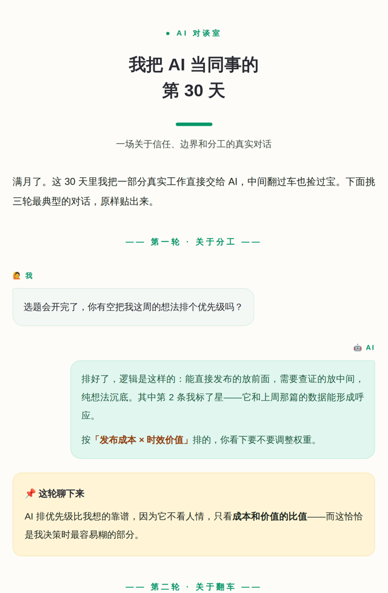</a><br><b>Mint Chat</b></td>
<td width="33%" align="center"><a href="https://88lin.github.io/gzh-skill-kit/docs/gallery/magazine.html">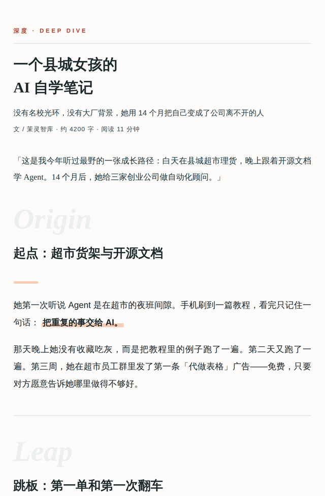</a><br><b>Peacock Magazine</b></td>
<td width="33%" align="center"><a href="https://88lin.github.io/gzh-skill-kit/docs/gallery/journal.html">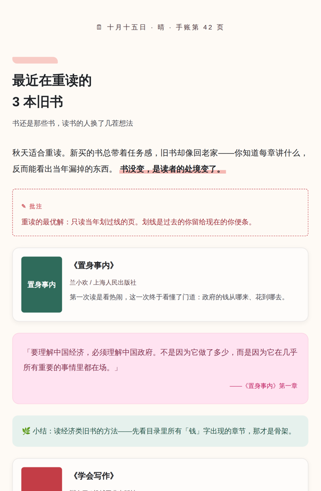</a><br><b>Coral Journal</b></td>
</tr>
<tr>
<td width="33%" align="center"><a href="https://88lin.github.io/gzh-skill-kit/docs/gallery/daily.html">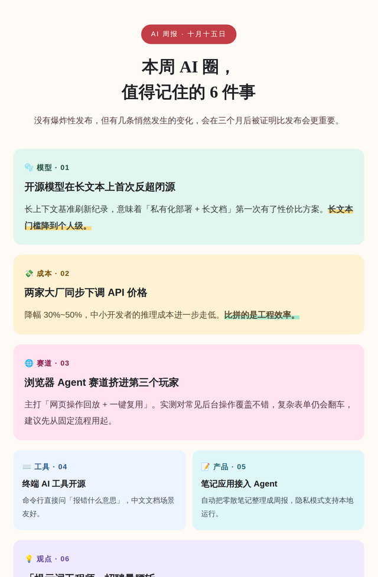</a><br><b>Coral Daily</b></td>
<td width="33%" align="center"><a href="https://88lin.github.io/gzh-skill-kit/docs/gallery/moyu-green.html">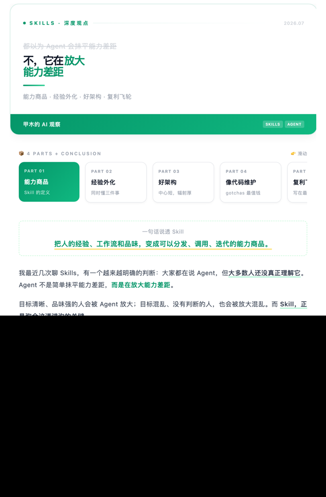</a><br><b>Moyu Green</b></td>
<td width="33%" align="center"><a href="https://88lin.github.io/gzh-skill-kit/docs/gallery/red-white.html">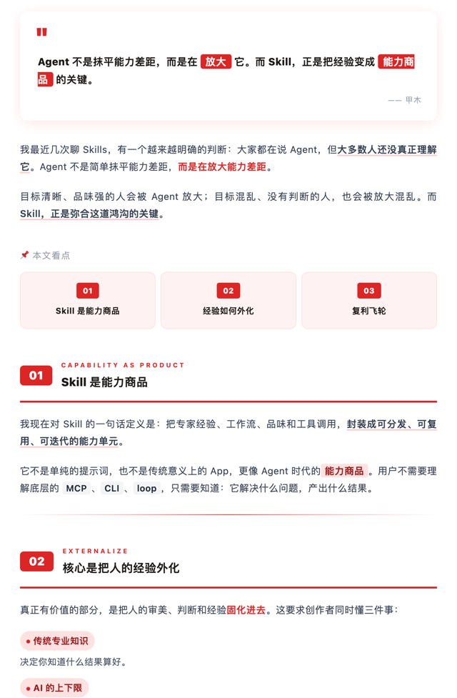</a><br><b>Red & White</b></td>
</tr>
<tr>
<td width="33%" align="center"><a href="https://88lin.github.io/gzh-skill-kit/docs/gallery/klein-blue.html">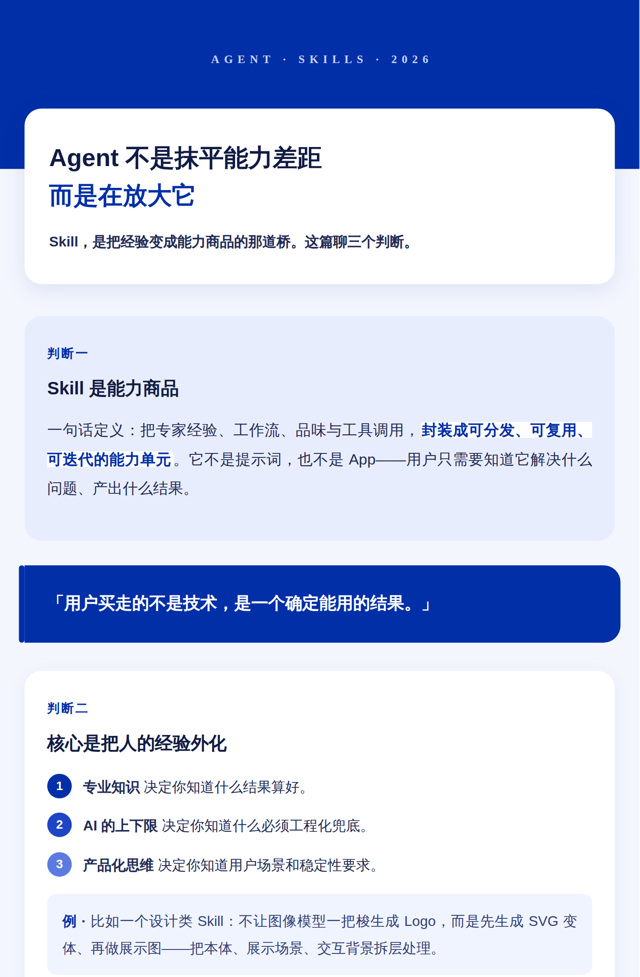</a><br><b>Klein Blue</b></td>
<td width="33%" align="center"><a href="https://88lin.github.io/gzh-skill-kit/docs/gallery/graphite-minimal.html">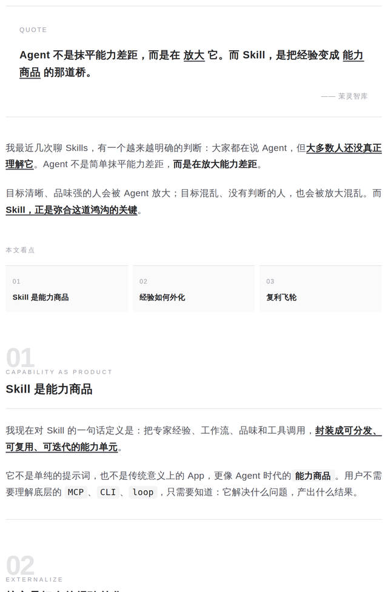</a><br><b>Graphite Minimal</b></td>
<td width="33%" align="center"><a href="https://88lin.github.io/gzh-skill-kit/docs/gallery/zen-whitespace.html">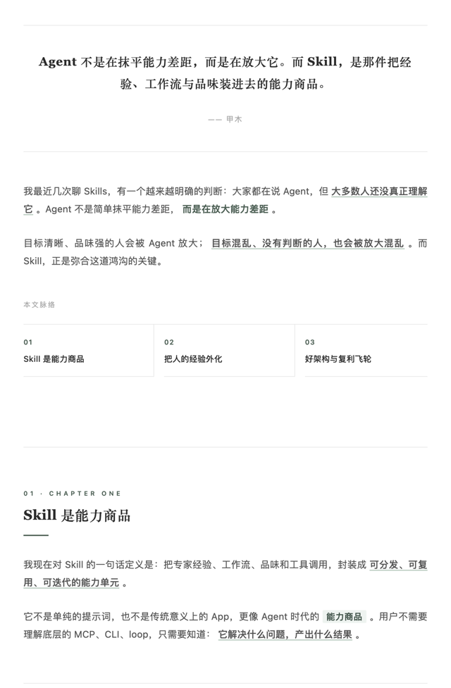</a><br><b>Zen Whitespace</b></td>
</tr>
<tr>
<td width="33%" align="center"><a href="https://88lin.github.io/gzh-skill-kit/docs/gallery/moyu-ticket.html">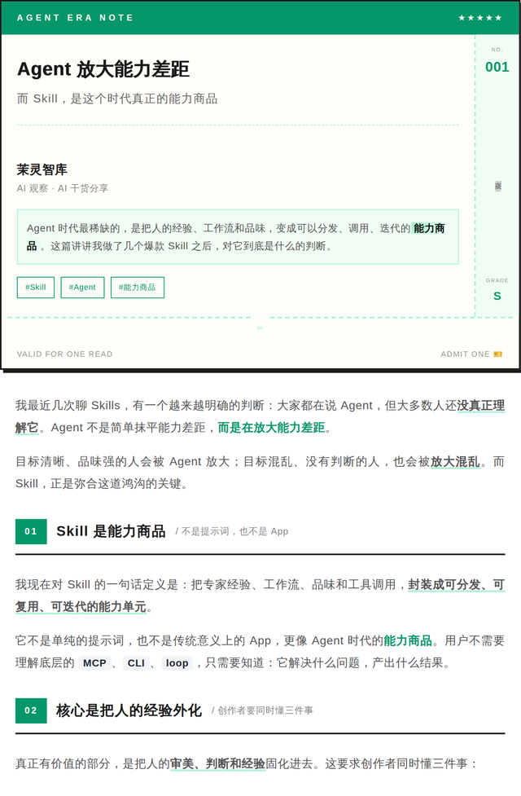</a><br><b>Moyu Ticket</b></td>
<td width="33%" align="center"><a href="https://88lin.github.io/gzh-skill-kit/docs/gallery/olive-journal.html"></a><br><b>Olive Journal</b></td>
<td width="33%" align="center"><a href="https://88lin.github.io/gzh-skill-kit/docs/gallery/index.html"><b>Open the live gallery ↗</b></a></td>
</tr>
</table>

</details>

<a id="wechat-api"></a>

## Optional: upload to the WeChat draft box

Manual copying does not need WeChat credentials. For automation, `wechat_draft.py` uploads inline images, a cover, and the article, creates a draft, and reads it back for verification. **It does not publish the article.** Review the draft in WeChat before publishing.

Prepare an Official Account with the required API permissions, its AppID / AppSecret, and a cover image. Check permissions and the IP allowlist in your account settings. In these examples, `article.html` means the **validated clean article fragment**; replace it with the actual file path.

### 1. Install dependencies and save the configuration

```bash
python -m pip install requests Pillow
```

Create `.wechat_config.json` in your home directory, save it as **UTF-8 without BOM**, and enter your actual credentials:

```json
{
  "WECHAT_APP_ID": "wx_your_appid",
  "WECHAT_APP_SECRET": "your_app_secret"
}
```

Default location: `%USERPROFILE%\.wechat_config.json` on Windows, or `~/.wechat_config.json` on macOS / Linux. Keep credentials and token caches outside the repository and out of Git.

<details>
<summary>Custom paths and multiple accounts (PowerShell / Bash)</summary>

These environment variables contain **file paths**, not the AppID / AppSecret values. Create the files and their parent directories first, then run the upload command in the same terminal.

Windows PowerShell:

```powershell
$env:WECHAT_CONFIG_FILE = "C:\wechat\account-a.json"
$env:WECHAT_TOKEN_FILE = "C:\wechat\account-a.token.json"
```

macOS / Linux:

```bash
export WECHAT_CONFIG_FILE="$HOME/.config/wechat/account-a.json"
export WECHAT_TOKEN_FILE="$HOME/.config/wechat/account-a.token.json"
```

The default token cache is `~/.wechat_access_token` and is bound to the configured AppID. Expiration, an account change, or a legacy cache without an AppID triggers a refresh. Use a separate `WECHAT_TOKEN_FILE` per account when switching between accounts. Set environment variables before launching the script or importing the module.

The CLI also accepts `WECHAT_COVER_PATH` as its default cover path, otherwise using `image_001.jpg` in the current directory. An explicit cover argument takes precedence.

</details>

### 2. Upload the article

```bash
python scripts/validate_gzh_html.py "/path/to/article.html"
python scripts/wechat_draft.py "/path/to/cover.jpg" "Article title" "Article summary" --html-file "/path/to/article.html"
```

Confirm **0 ERROR and 0 half-width punctuation WARN** before uploading. Covers support JPG / PNG; crop to 900 × 383 if suitable. The script generates a compressed thumbnail but does not compose or crop the cover for you.

- Local inline images resolve relative to the HTML file. They are checked, uploaded, and replaced with returned URLs; repeated references to the same file upload once.
- HTTP(S) image URLs remain unchanged. Check their availability in WeChat; local images can instead use the API upload flow.
- HTML is minified automatically before upload to reduce unwanted whitespace introduced from source indentation.
- Success returns the draft `media_id` and a body `nbsp` count. Readback checks the title, including Chinese characters and emoji.

<details>
<summary>Python integration and retrying a failed verification</summary>

Run from the repository root, or add the skill's absolute `scripts` path to `sys.path`:

```python
from pathlib import Path
import sys

sys.path.insert(0, "scripts")
from wechat_draft import DraftVerificationError, upload_and_cleanup

article = Path("article.html").resolve()
try:
    media_id, nbsp_count = upload_and_cleanup(
        cover_path="cover.jpg",
        title="Article title",
        digest="Article summary",
        html_content=article.read_text(encoding="utf-8"),
        base_dir=article.parent,
    )
    print(media_id, nbsp_count)
except DraftVerificationError as exc:
    print("Draft created; retry verification only:", exc.media_id)
    raise
```

`DraftVerificationError` means the draft was created but readback verification failed (CLI exit code `2`). Record the exception's `media_id` and retry verification of that existing draft:

```python
import sys
sys.path.insert(0, "scripts")
from wechat_draft import get_token, verify_draft

token = get_token()
media_id = "REPLACE_WITH_EXISTING_DRAFT_MEDIA_ID"
nbsp_count = verify_draft(token, media_id, "Article title")
print(nbsp_count)
```

Do not call the upload function again for the same article. `nbsp_count > 0` alone does not mean a layout error: a single nonbreaking space may be intentional. If you confirm unwanted runs of spaces, use:

```python
from wechat_draft import cleanup_draft_nbsp
cleanup_draft_nbsp(token, media_id)
```

Cleanup preserves individual spaces, author details, the original URL, and comment settings, then verifies the update by reading it back. Despite its name, `upload_and_cleanup()` handles pre-upload minification; cleanup of unwanted spaces after upload is a separate call.

</details>

<a id="faq"></a>

## Troubleshooting

| Problem | What to check |
| --- | --- |
| The agent does not use the skill | Confirm installation in a directory your client supports; request `gzh-design` explicitly or provide the actual `SKILL.md` path |
| A `scripts/...` file cannot be found | Run from the skill directory or use absolute script and input paths; quote paths containing spaces |
| Validation flags `script` / `style` in the preview | Validate the clean `.html` fragment, not `_预览.html` |
| The copy button fails | Follow the page's fallback instructions to select and copy the rendered article manually, excluding the toolbar and source code |
| Images appear locally but not in WeChat | WeChat cannot read local file paths; upload images in the editor or use the API flow for local inline images |
| Colors or spacing change after pasting | Fix validation findings, then check editor filtering and the mobile preview; static checks cannot guarantee every WeChat client's final rendering |
| PDF text is out of order or figures are missing | Correct the normalized Markdown and replace placeholders before layout; complex PDFs may need manual work |
| Configuration or token errors | Check JSON encoding and keys, credentials, API permissions, and the IP allowlist against the API error message |
| The CLI exits with code `2` | A draft exists but verification failed; save its `media_id` and retry verification without creating another draft |

**How do I update or customize themes?** Rerun the installation command for installer-managed copies. For a Git clone, run `git pull --ff-only` in the installation directory. Preserve custom changes first; register new themes through the [theme index](references/theme-index.md).

**Will every model produce the same result?** Components and scripts constrain styles and platform rules, but the model still interprets the article and selects components. Results depend on model and client capabilities. Test your setup with the sample article first.

<a id="development"></a>

## Scripts and maintenance

Each script has a specific job. Here, `article.html` represents an already generated article fragment:

```bash
# Check the theme component libraries
python scripts/component_lint.py .

# Validate the article, then create its copy preview
python scripts/validate_gzh_html.py article.html
python scripts/wrap_preview.py article.html

# Write minified HTML to a separate file, preserving the original
python scripts/minify_gzh_html.py article.html article.min.html

# Run regressions (requests and Pillow required)
python -m unittest discover -s tests -v
```

Component libraries must have **0 ERROR**; delivered articles must have **0 ERROR and 0 half-width punctuation WARN**. Validation covers known rules for forbidden markup/styles, text wrapping, independent block backgrounds, and Chinese punctuation. Inspect the actual preview as well.

CI uses Python 3.13 on Ubuntu and Windows for regressions, component checks, gallery validation, and PNG integrity. WeChat API tests use mocked responses. The mirror synchronization test requires a non-Windows platform with `rsync`; Ubuntu CI runs it, while Windows skips it.

```text
gzh-skill-kit/
├── SKILL.md                       # Agent workflow; skill name: gzh-design
├── references/
│   ├── theme-index.md             # Theme registry
│   ├── theme-*.md                 # Theme libraries and generator
│   ├── common-components.md       # Code, images, footnotes, and shared components
│   ├── format-normalize.md        # Word / PDF / text normalization
│   └── annotated-format.md        # Two-stage annotation specification
├── scripts/                       # Extraction, checks, minification, preview, upload
├── tests/                         # Regression tests
├── assets/
│   ├── sample-article.md          # Sample input
│   └── preview-template.html      # Copy preview wrapper
└── docs/gallery/                  # Long-form samples in all 14 themes
```

For themes, fixes, or documentation contributions, read the [contribution guide](CONTRIBUTING.md) and [evaluation cases](references/eval-cases.md). Most workflow and reference documents are in Chinese. A useful layout bug report includes a sanitized input excerpt, theme ID, validator output, and a screenshot.

---

<div align="center">

[Report a bug](https://github.com/88lin/gzh-skill-kit/issues/new?template=bug_report.md) · [Request a theme](https://github.com/88lin/gzh-skill-kit/issues/new?template=theme_request.md) · [Contribute](CONTRIBUTING.md)

Licensed under [AGPL-3.0](LICENSE). If this saves you editing time, a Star helps you find it again.

</div>
