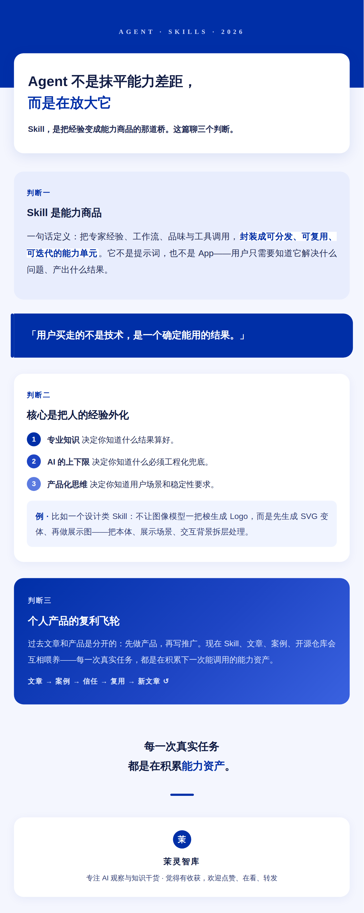
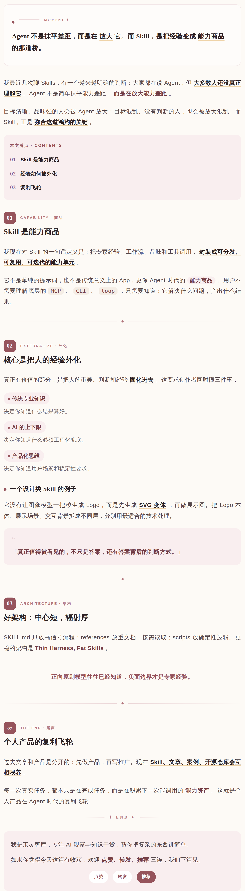
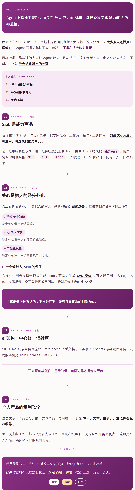

# 全部 10 套主题效果预览 · All 10 Themes

同一篇长文（《做了些爆款 Skills 以后，我对 Skills 的看法》），用 10 套精选主题排版，全部含真实长图/交互预览（含配图、引言卡、编号章节、金句、名词旁注等完整组件）。

> The same long-form article laid out in all 10 curated themes (all 10 previews below). Back to [README](../README.md).

<table>
<tr>
<td width="33%" align="center"> <b>摸鱼绿 Moyu Green（默认）</b></td>
<td width="33%" align="center"> <b>红白色系 Red &amp; White</b></td>
<td width="33%" align="center"> <b>石墨极简风 Graphite Minimal</b></td>
</tr>
<tr>
<td align="center"> <b>留白禅意风 Zen Whitespace</b></td>
<td align="center"> <b>摸鱼票据风 Moyu Ticket</b></td>
<td align="center"> <b>橄榄手记 Olive Journal</b></td>
</tr>
<tr>
<td align="center"><a href="https://88lin.github.io/gzh-design-skill/docs/gallery/index.html"><b>打开完整交互预览</b></a> <b>科技钴蓝 Tech Cobalt</b></td>
<td align="center"> <b>克莱因蓝 Klein Blue</b></td>
<td align="center"> <b>豆沙 Red Bean</b></td>
</tr>
<tr>
<td align="center"> <b>藕荷 Orchid</b></td>
<td colspan="2"></td>
</tr>
</table>

---

> 以上为每套排版的首屏长图；完整可交互 HTML 见 [`gallery/index.html`](gallery/index.html)（在线预览：https://88lin.github.io/gzh-design-skill/docs/gallery/index.html）。每套主题的主色 / 适用场景 / 英文标识见 [`../references/theme-index.md`](../references/theme-index.md)。需要别的风格可用[主题生成器](../references/theme-generator.md)现生成一套。
